# Construction & Interior Design Firm — studio website

**Status:** live at [buildwithsnc.com](https://buildwithsnc.com): 32 pages (Oct 2026), including 5 blog articles and 17 project pages showcasing 14 projects.\
**My role:** brief, content structure and an AI-assisted build (I directed AI coding tools and tested every change), through to deployment.

SNC is a South Delhi construction and interiors studio. The job was to show craft, carry the studio's project portfolio, and turn browsers into a first conversation.

It's a static site (no framework or page builder) with strong art direction (dark, editorial, gold accents), an animated 3D-floorplan hero, and two service verticals told as their own journeys.

Screenshots are from a demo build captured in Sep 2026:
- "abBytes" (my GitHub handle, not a company) stands in for SNC's name in most headings, and SNC's own name still appears in places. Wherever a capture says "abBytes", it means SNC's studio, not a business of mine.
- Site footers, contact cards and the studio's track-record figures (years in practice, homes built, follower counts) are cropped out, so no phone number or email appears. Those figures are SNC's marketing copy; they are not this site's portfolio and not a claim about me.
- Named testimonials, client quotes and social-media tiles are cropped out. House numbers, plot blocks and the studio's street address are cropped or edited out; only locality names remain. On the desktop home capture, a stray placeholder label at the foot of the hero render is softened.

*The source is in a private repo; walkthrough on request.*

---

## The site
- **Home** — a cinematic 3D-cutaway hero, the studio's four signature "registers", and a from-plot-to-keys narrative.
- **Interiors** — the design-and-build story: pick a mood, "what design looks like before it's built", the execution habits, a tier/area cost configurator, and material registers.
- **Construction & Collaboration** — the ground-up build and plot-collaboration offer.
- **Projects** — a filterable portfolio of 17 project pages showcasing 14 projects (construction / interior / commercial / for sale). Project pages carry a hero, project notes, specifications and related homes; most also have a walkthrough video, a 3D isometric plan and an area schedule.
- **Blog** — 5 long-form articles (reading a builder floor, Italian marble in Delhi homes, plot collaboration…).
- **Contact** — an enquiry form that tags 5 enquiry types, with WhatsApp / call shortcuts.

Plain HTML, modern CSS and vanilla JS, with no framework, built AI-assisted (IntersectionObserver reveals, a scroll-driven hero, JSON-driven project/blog data).

---

## Screenshots
Long pages show their top section here; click an image or its link for a longer capture.

### Home
The animated 3D-floorplan hero, the four signature themes and a featured project: *"Life is too short for ordinary spaces."*
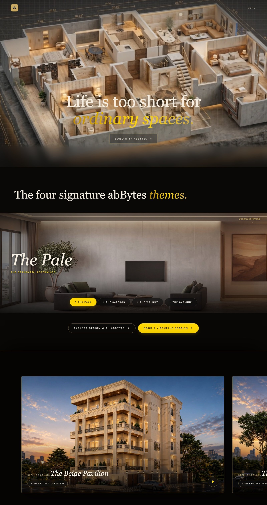

### The two verticals
**Interiors** — design → build, one team, one contract · longer capture: [part 1](screenshots/d-interiors.jpg) · [part 2: process, cost configurator, materials](screenshots/d-interiors-process.jpg) (the finished-work video section, a quote band and the enquiry form are left out)
[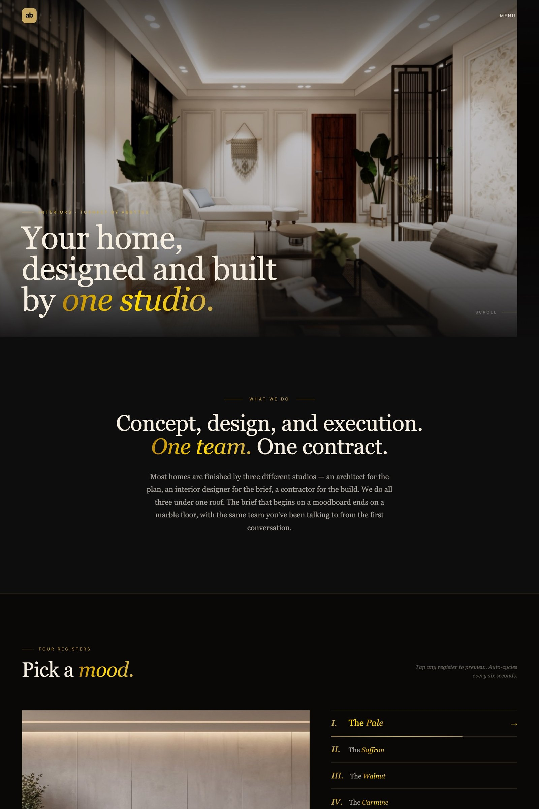](screenshots/d-interiors.jpg)

**Construction & Collaboration** · [build process, materials and recent work](screenshots/d-construction.jpg) (the sections quoting the studio's track record are left out)
[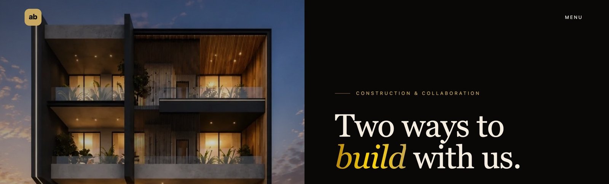](screenshots/d-construction.jpg)

### The portfolio
**Projects** — a filterable portfolio: 17 project pages showcasing 14 projects · [all cards](screenshots/d-projects.jpg)
[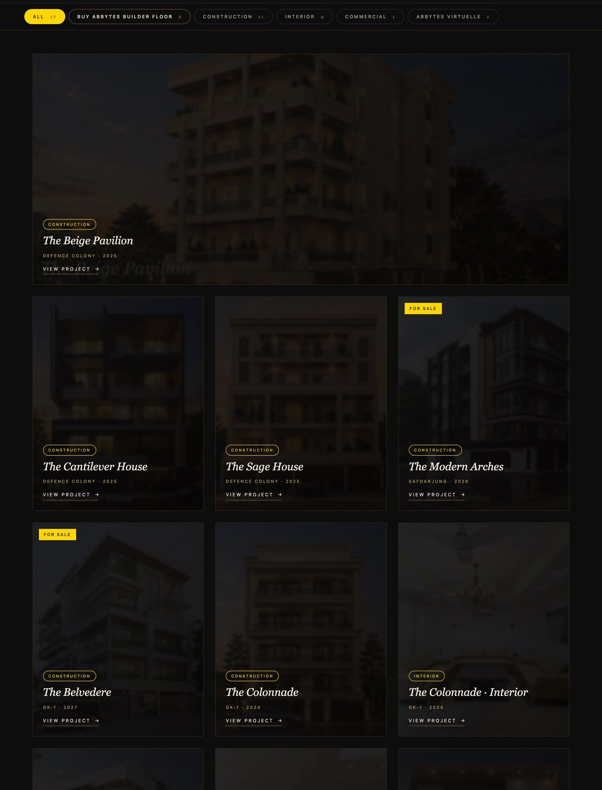](screenshots/d-projects.jpg)
*The cards were captured before their reveal animation finished, so they look dark here; the project pages below show what each card opens.*

**The Carved House** — project notes, walkthrough, 3D isometric plan, specifications · [longer capture](screenshots/d-project-carved-house.jpg)
[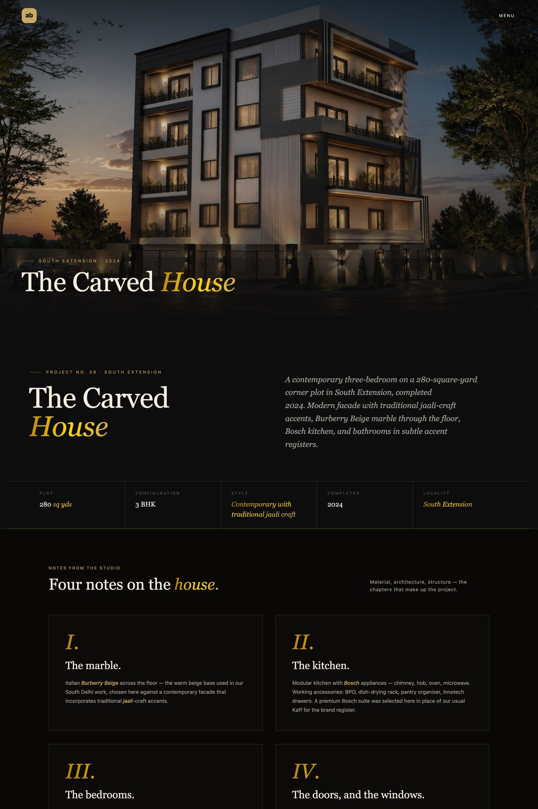](screenshots/d-project-carved-house.jpg)

**The Colonnade** — down to the related homes · [longer capture](screenshots/d-project-colonnade.jpg)
[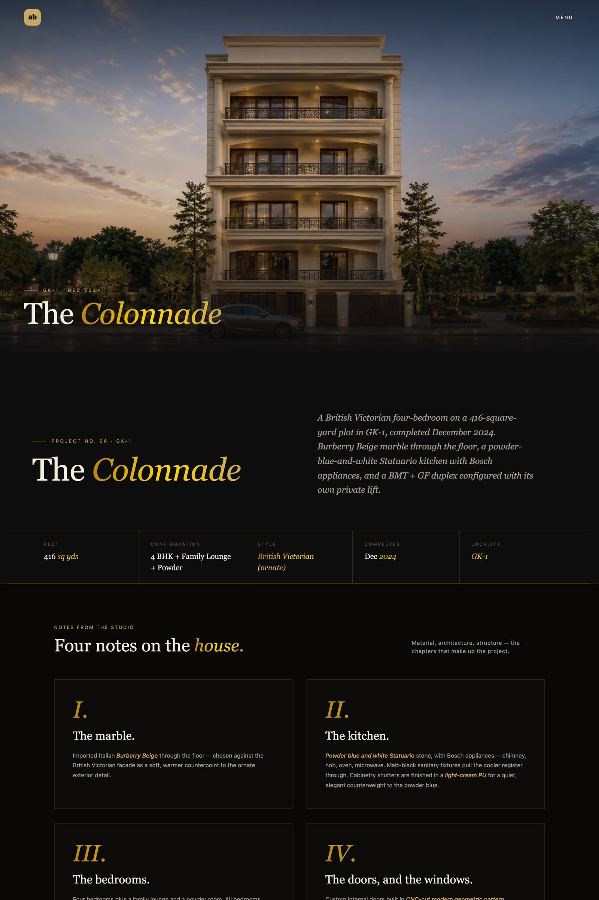](screenshots/d-project-colonnade.jpg)

### Blog & contact
**Blog index**
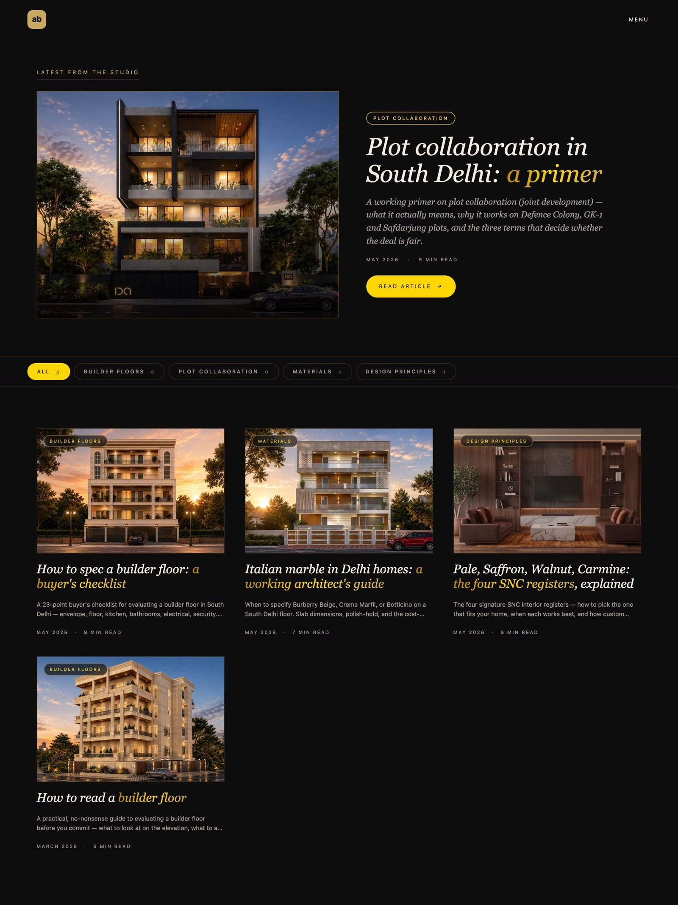

**Article** (top of the page only)
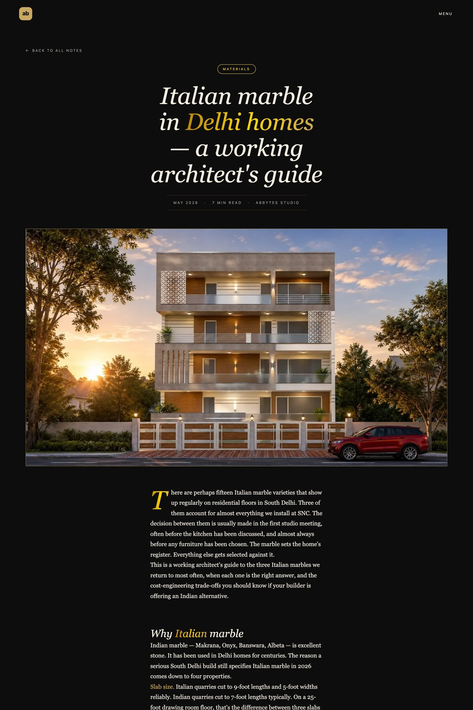

**Contact** (the enquiry form; the studio-details card beside it is cropped out)
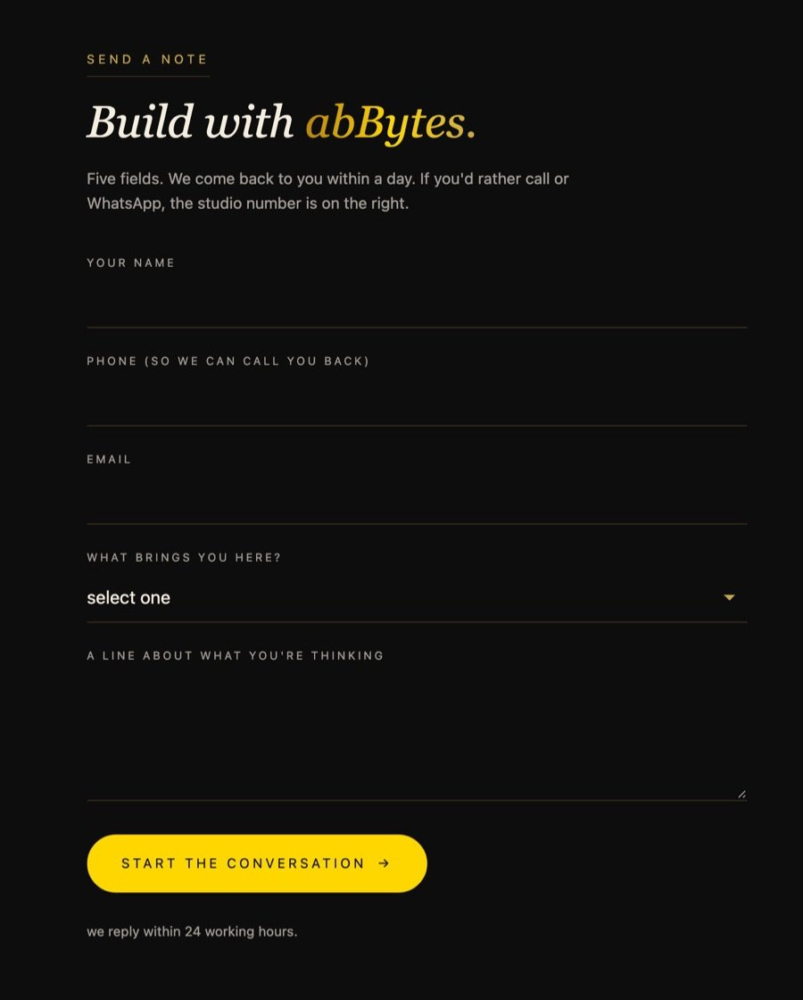

### Mobile
Top of each page; click for a longer capture (Construction, Article and Contact show the top only).

| Home | Interiors | Construction | Projects | Project detail |
|---|---|---|---|---|
| [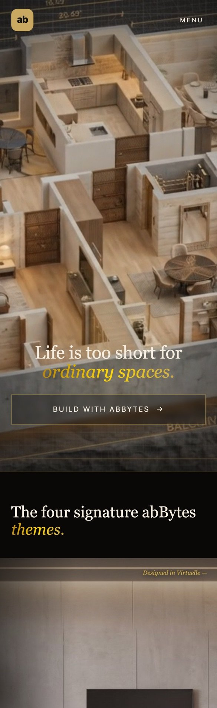](screenshots/m-home.jpg) | [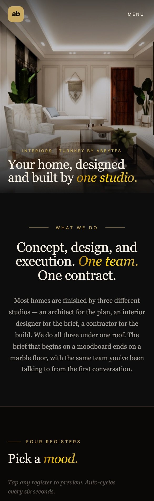](screenshots/m-interiors.jpg) | 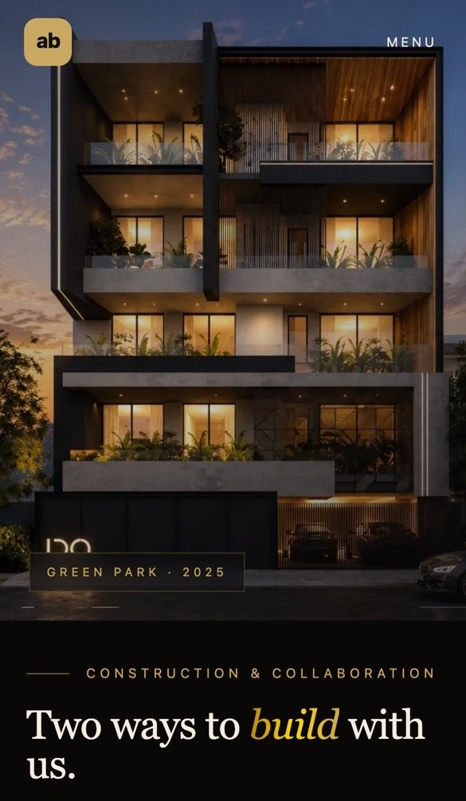 | [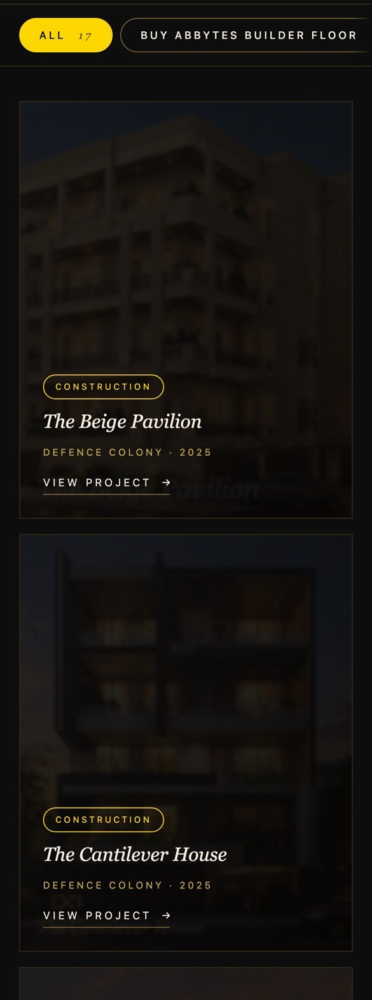](screenshots/m-projects.jpg) | [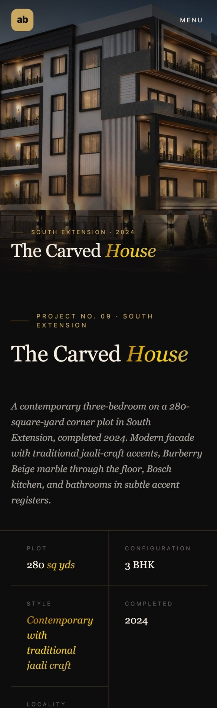](screenshots/m-project-carved-house.jpg) |

| Project detail | Blog | Article | Contact | |
|---|---|---|---|---|
| [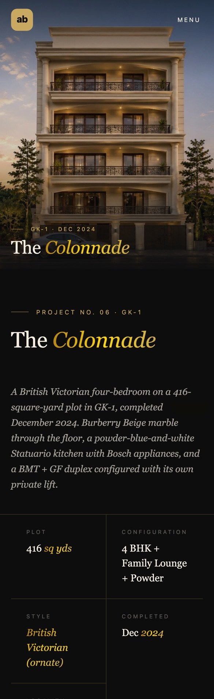](screenshots/m-project-colonnade.jpg) | [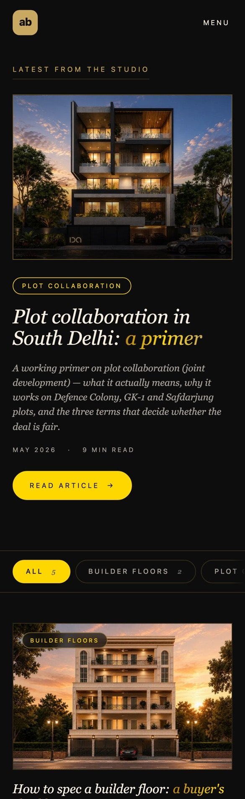](screenshots/m-blog.jpg) | 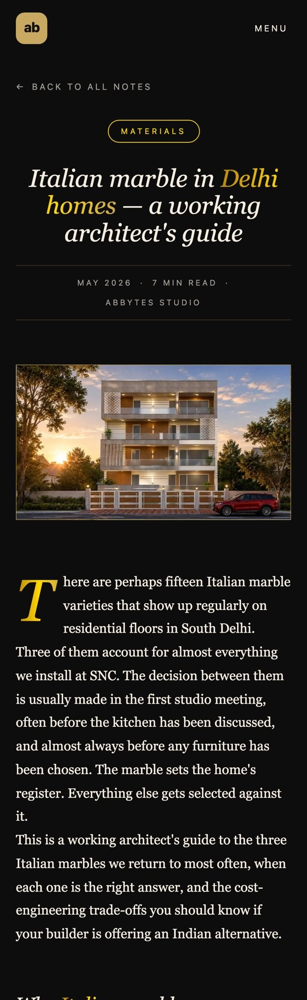 | 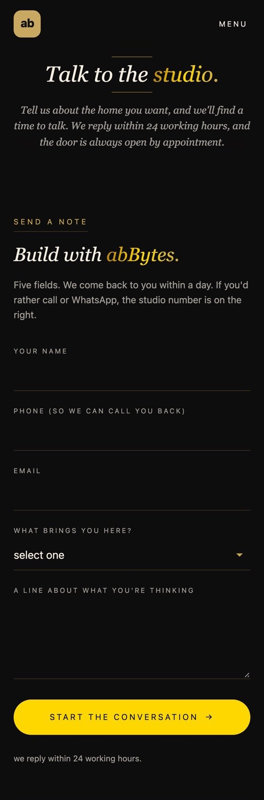 | |

---

## Tech
HTML5 · CSS3 (custom design tokens, dark editorial theme) · vanilla JS · JSON-driven content · responsive / mobile-first · IntersectionObserver + scroll-driven animation · AI-assisted build

---
Developed by **[@abBytes-sudo](https://github.com/abBytes-sudo)** for SNC

© 2026 [@abBytes-sudo](https://github.com/abBytes-sudo). Write-up and screenshots shared for portfolio review; not licensed for reuse. Site content and photography belong to SNC.
